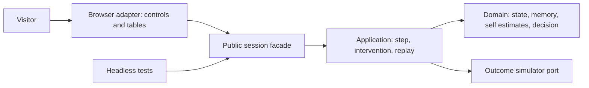

# ADR-013 — Separate experiential self-model laboratory

Status: implemented candidate; scientific and human acceptance pending. Date:2026-10-18. Drivers: user clarification, SELF-01–16, SCI-02, ARCH-01. Does not rename or silently replace D2 RF23/RF24 historical gridworld comparisons.

## Context and alternatives

The old BFS domain models a changing external map with a supplied destination. It cannot communicate retained experience constructing a model of the agent. Alternatives: relabel BFS (rejected: wrong question); add a scripted conversational character (rejected: plausible narration is not a demonstrated mechanism); a remote general agent or heavy neural model (deferred: unnecessary infrastructure/cost and unclear experimental control); a small explicit functional self-model (chosen as inspectable first experiment).

## Decision

Create a distinct domain/application/public-facade/browser-adapter boundary. Domain owns internal state, retained episodes, posterior estimates and utility decomposition. Application supplies only observed outcomes via an outcome port and manages reproducible sessions and comparisons. Browser renders snapshots and sends commands through the public facade. It does not choose outcomes, assign personalities or modify private session state.

A Beta(2,2) prior is updated by retained task/context outcomes. Adaptive memory heuristic combines surprise, later-observed predictive usefulness, diversity and recency. It is not called a learned retention controller. Utility coefficients and homeostatic action repertoire are authored assumptions. This makes the difference between learned estimates and designed decision mechanism explicit.

Equivalent text: both browser and headless callers enter the session facade; application coordinates domain decisions and a separate outcome source; only observed outcomes return to domain. Domain has no browser, network, storage, Astro or rendering dependency.

## Consequences and risks

Positive: inspectable causal controls, bounded offline execution, reproducible records, replaceable interface. Cost: narrowly designed environment and policy; richer representation, continual learning and learned retention are future research. Observational episodes can confound task difficulty and internal effects. Recovery/calibration outcomes are not evidence of emotion or consciousness. More visual complexity would not fix these limits.

Reversible: preserve old gridworld and its schemas, introduce a distinct modelId/schema, and isolate the new module. Evidence: `tests/self-model.test.mjs`; browser test actual compiled module; domain dependency validation. Complete conformance is not inferred from directory names.
