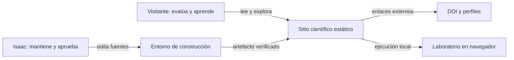

# 04 — Macroelementos, responsabilidades y vistas

Control: D2 · 18-10-2026 · arquitectura objetivo, no despliegue certificado. Referencias: D1 II §4; BROWN PDF 43–52; HARD PDF 67–68 y cap. 5. Las rutas objetivo deben comprobarse al migrar; las históricas proceden del dossier y los parches.

## Niveles

O/IF explican finalidad. M identifica responsabilidad lógica. Un componente implementa comportamiento dentro de M. Un adaptador conecta un mecanismo. Un contenedor de ejecución representa navegador o entorno de construcción, no necesariamente Docker ni una carpeta. `/publications/` es una ruta, no un servicio. La unidad de publicación es el artefacto estático combinado.

## M-01 — Catálogo científico y editorial

**Responsabilidad:** poseer identidad pública, preguntas, proyectos, publicaciones, referencias, estado y procedencia. **Entradas:** ediciones autorizadas. **Salidas:** modelos de presentación y bibliografía. **Propiedad:** registro canónico; las copias públicas son salidas derivadas. No posee métricas del agente ni configura Three.js.

Componentes objetivo: catálogo tipado, validación editorial, selectores públicos y generador BibTeX/metadatos. La lectura de archivos es un adaptador de construcción; la validación de reglas puede ser pura. La aprobación editorial es un dato explícito, no un booleano inventado al construir.

Registro inválido bloquea publicación conforme a la política; nunca se transforma un borrador en resultado. Un enlace caído no prueba inexistencia de un artículo. Las representaciones se generan desde la misma autoridad. Interfaces CAT-01/CAT-02. El parche propone `site/src/data/publications.json` y `tools/catalog.mjs`; se conserva una sola fuente aunque la reubicación futura sea distinta. No admite datos privados sin finalidad ni métricas de reputación fabricadas.

## M-02 — Experiencia pública

**Responsabilidad:** composición, jerarquía visual, navegación, foco, accesibilidad, animaciones y escena. **Entradas:** contenido validado, preferencias y acciones. **Salidas:** HTML/CSS y presentación dinámica. No decide reglas del agente ni invoca Quarto por visita.

Componentes: shell, navegación común, páginas, presentadores, política de movimiento y renderer periférico. GSAP/Three.js son mecanismos. Un error de escena conserva CSS; un error de laboratorio deja aviso local sin impedir publicaciones. Iniciar/destruir un adaptador no duplica listeners, observadores o temporizadores. Una elección no persistible permanece descrita como elección de sesión.

Interfaces LAB-01/LAB-02 para solicitudes, LAB-03 para vistas, MOT-01 para preferencias y CAT-02 para contenido. Históricamente: componentes Astro, BaseLayout, main, motion, animations y universe. Objetivo: páginas que componen y una UI que llama al API público, sin escribir `world.agent`, paredes o contadores.

## M-03 — Laboratorio de agentes

**Responsabilidad:** episodio determinista con mundo, modelo, observación, planificación, intervención y métricas. **Entradas:** configuración admitida y comandos. **Salidas:** snapshot independiente, eventos y episodio verificable. **Propiedad:** estado vivo privado por sesión, sin alias mutables públicos.

Componentes: valores de mundo/modelo, sensor, política de revisión, BFS/desempate, casos de uso y contratos. Política de revisión y orden BFS son dimensiones distintas. Un comando inválido no muta estado. Un replay incompatible no toca la sesión interactiva. Un baseline bloqueado no incorpora exploración no implementada. El dominio no conoce rutas HTTP, archivos, descargas, DOM o reloj de animación.

Interfaces LAB-01…LAB-06. Fuente histórica: `site/src/scripts/agent-world.mjs`; el parche añade `episode.mjs`. Objetivo: `site/src/modules/agent-lab/{domain,application,contracts,adapters}` y una entrada pública pequeña. La migración conserva comportamiento antes de introducir otra política experimental.

## M-04 — Publicación científica

**Responsabilidad:** transformar fuentes científicas en recursos navegables bajo `/research/`. **Entradas:** fuentes permitidas, configuración, herramienta y catálogo. **Salidas:** árbol verificado y manifiesto. No es servidor de inferencia.

Componentes: selección de fuentes, adaptador CLI Quarto, normalización de enlaces, verificación de salidas y promoción recuperable. La normalización actúa únicamente sobre enlaces de portal reconocidos por contrato; no reescribe bibliografía externa o anclas indiscriminadamente. Render fallido, timeout, nota ausente o archivo inesperado bloquean la entrega nueva y conservan la anterior.

Interfaces PUB-01/PUB-02. Ubicación: `research/`, wrapper, normalizador y verificadores. Un marcador de directorio no demuestra integridad; versiones de referencia no sustituyen versiones efectivas. Se integran archivos, no dos despliegues compitiendo ni un iframe que esconda la frontera.

## M-05 — Entrega, gobierno y recuperación

**Responsabilidad:** verificar, construir, evaluar contratos, empaquetar, instalar, desplegar y recuperar con identidades. **Entradas:** árbol fuente, lockfile, herramientas, políticas y autorización. **Salidas:** artefactos, reportes y registros. D2 y su verificador forman parte del control, no del runtime público.

Componentes: preflight, orquestador, pruebas, inventario, transacción local, restauración, CI de lectura, despliegue y smoke. Windows, Linux y navegador tienen evidencias distintas. Falta de fuente o permiso aborta antes de reemplazar. Diario desconocido obliga a detenerse. Una carpeta backup no equivale a restauración ensayada. Un workflow verde no sustituye verificación pública.

Interfaces DEL-01…DEL-03. `.git` y archivos no gestionados quedan fuera de reemplazo. Las evidencias completas no tienen por qué ser públicas; el manifiesto público excluye rutas personales. Ubicación: tools, workflows, scripts, tests y docs.

## Vista de contexto

Las flechas son interacciones etiquetadas; B es entrega, S contenido servido y L ejecución en cliente. Vista objetivo D2, no afirmación de publicación.

## Construcción frente a ejecución

La disponibilidad del sitio anterior no depende de lograr una nueva compilación. En ejecución, el navegador consume archivos y ejecuta el laboratorio; no llama al Node/Quarto del autor. Esta frontera permite una unidad de publicación sin convertir generadores en microservicios.

## Dependencias y límites

| Consumidor | Puede conocer | No puede conocer |
|---|---|---|
| Núcleo M-03 | Valores y reglas del laboratorio | DOM, filesystem, red, Astro, GSAP, Three.js |
| Casos de uso M-03 | Núcleo y contratos propios | Implementación concreta de adaptadores |
| Adaptador DOM | API pública y modelos de vista | Escritura del estado interno |
| Presentación editorial | Modelos públicos del catálogo | Borradores privados y reglas de instalación |
| Orquestador de build | Puertos de herramientas y políticas | Sesión interactiva del visitante |
| Cuaderno compilado | Recursos estáticos válidos | Rutas locales y proceso Quarto vivo |

Una relación de archivos generados no equivale a una importación de runtime. El análisis de dependencias distingue etapas para no convertir la composición de build en un ciclo falso. Todos los enlaces de datos indican qué módulo posee la fuente.

## Cambio localizado

Colores: M-02 y pruebas visuales, no motor. Sensor: M-03, contrato, protocolo y ejemplos, con nueva identidad experimental. Nota: M-01/M-04, fuentes permitidas y enlaces. Hosting: M-05 y URLs, no transición cognitiva. Se verifica con diffs y regresión; no se presume por dibujar cajas.
